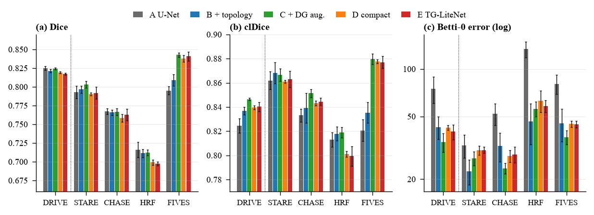

# TG-LiteNet: compact, topology-aware retinal vessel segmentation under dataset shift

CSD361 *Introduction to Machine Learning*, final project, Shiv Nadar Institution of Eminence.
Abhiraj Agarwal (2510110002), Shashwat Rajan (2510111019), Tanish Shitanshu (2510110008).

A **pre-registered study**, not a new method: models are trained on **DRIVE only** (15 training + 5 validation images) and tested, without
any adaptation, on **STARE, CHASE_DB1, HRF** and **FIVES**. Every rule (data roles, selection criteria, statistics) was written and hashed
before any target image was evaluated. The study asks what a topology loss, robustness augmentation, a compact backbone and uncertainty
estimates each contribute to overlap, connectivity, the generalisation gap, cost and reliability, and then shrinks the model to about
66K parameters and tests four new topology-based ideas.

* Paper (IEEE, 8 pages): [`paper/main.pdf`](paper/main.pdf), source in [`paper/`](paper/main.tex)
* Project website (interactive): [`docs/index.html`](docs/index.html) (`python -m http.server --directory docs`, or GitHub Pages)
* Protocols: [`protocol/PROTOCOL.md`](protocol/PROTOCOL.md) (v2) and [`protocol/PROTOCOL_v2.1.md`](protocol/PROTOCOL_v2.1.md)

## 1. Headline findings (all numbers from `results/`, native resolution, unseen = mean of STARE, CHASE_DB1, HRF)

| Question | Answer |
|---|---|
| Does a topology loss help? | It lowers the raw Betti-0 error from 72.8 to 33.9 (stage A to B), but deleting small fragments gives **every** model about 4.5, so raw fragment counts are not a reliable measure of connectivity. |
| What does topology cost in Dice? | Almost nothing once the threshold is tuned on DRIVE validation: tuned unseen Dice is 0.762 (A), 0.775 (B), 0.789 (C), 0.780 (E). The cost at threshold 0.5 is mostly calibration. |
| Does a compact backbone pay off? | A plain 486K U-Net is about 31x faster on CPU than the 31 M U-Net (30 ms vs 936 ms) for about 0.01 Dice. Depthwise convolutions were slower than plain ones at equal accuracy. |
| How small can it get? | The v2.1 model has **66,125 parameters** (469x fewer than the U-Net), 2.73 GFLOPs, about 25 ms per image, 109 KB as INT8: **0.768** unseen Dice (tuned), **0.779** with calibre-guided scale selection. Published lightweight networks score 0.03 to 0.04 higher under different protocols. |
| What did the four new ideas show? | **N2** calibre-guided test-time scale selection: supported (+0.011 Dice, clear; +0.034 on HRF; on thick-vessel FIVES the default scale is better). **N1** connectivity reliability score: a promising lead (secondary connectivity scores rank failures better than entropy for most models). **N3** topology-aware distillation: open, no clear effect at 3 seeds. **N4** skeleton-level consistency: a Dice trade-off, so pixel-level consistency stays recommended. |
| Is uncertainty useful? | Entropy is a useful pixel-level signal (rho about 0.34); ranking whole images by reliability and transferring calibration from DRIVE are the next open challenges. |




## 2. Versions and branches

| | v1 (git `main`, tag `v1-final`) | v2 (branch `v2`) | v2.1 (branch `v2.1-tglite70k`, **final**) |
|---|---|---|---|
| Idea | compact, topology-aware vessel model | same study, rebuilt under a strict protocol | 66K-parameter model + four new ideas |
| Selection | partly after seeing results | DRIVE validation only, protocol hashed before any target evaluation | DRIVE validation only, hashed addendum |
| Targets | STARE, CHASE_DB1, HRF | + FIVES (200 images) | same |
| Main model | 0.21 M depthwise | 0.49 M plain U-Net | 66K U-Net (channels 8-12-16-24-32) |
| Trained models | 70 (Kaggle, Colab) | 76 (RTX A4000) | 38 (RTX A4000) |

The `final-submission` branch contains v2.1 (a strict superset of v2: the v2 files are identical) plus the paper (`paper/`) and the website (`docs/`).
`results/` holds the v2 study and `results/v21/` the follow-up.

## 3. Repository map

```
configs/      base.yaml (all hyper-parameters), experiments.yaml (v2 runs), v21.yaml (v2.1 runs)
protocol/     PROTOCOL.md, PROTOCOL_v2.1.md, decisions*.json (budget, backbone, size rule, freeze records with SHA-256)
src/tglite/   data/ (prepare, preprocess, augment, dataset), models, losses, train, inference, selection, evaluate, metrics,
              efficiency, eval21, int8, suite, suite21, report, report21
scripts/      run_all.py (v2), run_v21.py (v2.1), monitor.py, prepare_data.py, train.py (one run), make_report.py,
              make_paper.py (paper tables/figures/numbers), make_site_data.py (website data), export_assets.py, check_scale_rule.py
tests/        unit tests (losses, metrics, selection, v2.1 additions, resume)
results/      committed, generated results: tables, figures, per-run records; v21/ holds the follow-up; nothing is edited by hand
paper/        main.tex, overview.tex, generated/ (tables, number macros), figures/, main.pdf
docs/         website: index.html, style.css, app.js, data/site.js, assets/ (example images and probability maps), img/, paper.pdf
reports/      GROUP_UPDATE_v2.1.md (internal write-up)
data/         downloaded archives (not committed, see data/README.md)
runs/         checkpoints and saved probability maps (not committed, about 14 GB)
```

## 4. Setup (Windows, NVIDIA GPU; any Python 3.10+)

```powershell
conda create -p .venv python=3.12 pip -c conda-forge
.venv\python.exe -m pip install torch torchvision --index-url https://download.pytorch.org/whl/cu128
.venv\python.exe -m pip install -r requirements.txt
.venv\python.exe -m pip install -e .
.venv\python.exe -m pytest
```

`requirements-lock.txt` lists the exact versions that produced the results (PyTorch 2.11, CUDA 12.8).

## 5. Data (not included)

Download the archives listed in [`data/README.md`](data/README.md) into `data/` (unextracted): DRIVE (grand-challenge.org, test labels from the PaddleSeg
mirror), STARE (cecas.clemson.edu/~ahoover/stare), CHASE_DB1 (Hugging Face mirror `MedOtter/CHASE_DB1`), HRF (www5.cs.fau.de/research/data/fundus-images) and
FIVES (doi 10.6084/m9.figshare.19688169). Then `python scripts/prepare_data.py --overview` checks counts and checksums and prepares standardised copies.

## 6. Running

```powershell
python scripts/run_all.py --smoke      # 10-minute end-to-end check
python scripts/run_all.py              # the v2 study (resumable; timings in results/runs/_suite/suite.log)
python scripts/run_v21.py              # the v2.1 follow-up (resumable, about 18.5 h)
python scripts/monitor.py              # live progress
```

Everything is resumable: finished jobs are skipped and training continues from its last checkpoint. Order: data, pilot/backbone selection (DRIVE only),
**freeze**, primary stages A-E, factorial, topology variants, warm-up, controls, width; v2.1 repeats the pattern with its own freeze.

## 7. Rebuilding the paper and the website from the committed results

```powershell
python scripts/make_paper.py           # paper/generated/*.tex, paper/figures/*, number macros from results/
cd paper; pdflatex main; pdflatex main
python scripts/make_site_data.py       # docs/data/site.js, docs/assets/, docs/img/, docs/paper.pdf
python -m http.server --directory docs # open http://localhost:8000
```

Every number in the paper and on the website is read from `results/` (per-image metrics of every model on every test image, per-run configs, training curves,
DRIVE-validation choices, costs, decision records and suite logs); only the trained weights and saved probability maps are not committed.

## 8. Scope and limitations

Fifteen training images from one dataset; three seeds for ablations (low power: "not shown" is not "no effect"); the targets are held out, not untouched (v1 results were
known); the pre-registered size rule selected the 212K depthwise network, not the 66K model, as the formal v2.1 headline (we show both); scale selection hurts on FIVES; INT8
shrinks the file but was slower than FP32 on the test CPU; published numbers are context only because their protocols differ.

## 9. Licence and data

Code: MIT ([LICENSE](LICENSE)). The datasets keep their own licences and are not redistributed; please cite DRIVE (Staal et al. 2004), STARE (Hoover et al. 2000),
CHASE_DB1 (Fraz et al. 2012), HRF (Budai et al. 2013) and FIVES (Jin et al. 2022).
