<div align="center">

# TG-LiteNet

### A 66K-parameter retinal vessel segmenter that travels across cameras

Compact, topology-aware vessel segmentation, trained on **15 DRIVE images** and tested **without any adaptation** on four unseen datasets.
A pre-registered study with **114 trained models**, a **109 KB** INT8 network and a label-free **test-time scale rule**.

[](paper/main.pdf)
[](https://deltasthicc.github.io/ML-Project/)
[](requirements-lock.txt)
[](LICENSE)

<table>
  <tr>
    <td align="center">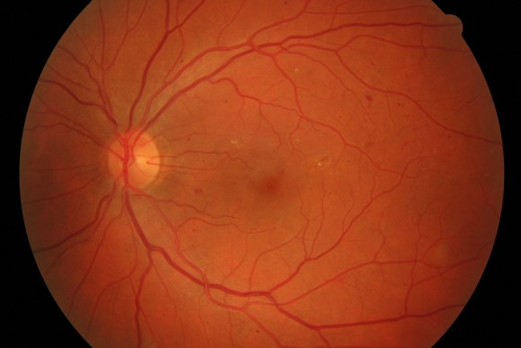<br><sub><b>Unseen HRF photo</b><br>a camera the model never saw</sub></td>
    <td align="center">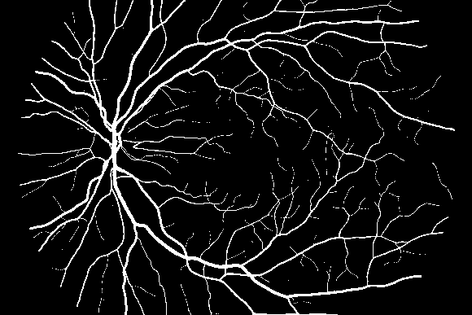<br><sub><b>Expert label</b><br>ground truth</sub></td>
    <td align="center">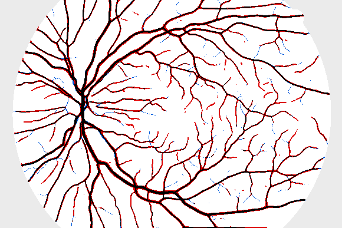<br><sub><b>66K model</b><br>Dice 0.692</sub></td>
    <td align="center">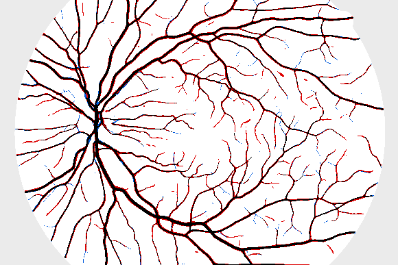<br><sub><b>+ scale selection</b><br>Dice 0.739</sub></td>
  </tr>
</table>

<sub>Black: correct vessel, red: false alarm, blue: missed. Example image, normalised scale.</sub>

</div>

CSD361 *Introduction to Machine Learning*, final project, **Group 22**, Shiv Nadar Institution of Eminence.
**Abhiraj Agarwal** (2510110002, Topology), **Tanish Shitanshu** (2510110008, Generalisation), **Shashwat Rajan** (2510111019, Lite).

---

## Contents

[At a glance](#at-a-glance) · [The idea](#the-idea) · [Team](#team-and-responsibilities) · [Results](#results) · [The four new ideas](#the-four-new-ideas) · [Versions](#versions-and-branches) · [Data](#data) · [Quick start](#quick-start) · [Reproduce](#reproduce-everything) · [Repository map](#repository-map) · [Scope](#scope-and-limitations) · [Cite and licence](#cite-and-licence)

---

## At a glance

| | |
|---|---|
| **66,125 parameters** | **469x** smaller than the 31 M U-Net it is compared with, **7x** smaller than our v2 model |
| **0.768 → 0.779 Dice** | on the unseen datasets (STARE, CHASE_DB1, HRF), tuned threshold, then with calibre-guided scale selection |
| **109 KB** | as a static INT8 network (266 KB as FP32) with unchanged Dice; about 25 ms per image on a desktop CPU |
| **+0.034 Dice on HRF** | from a label-free test-time rule that needs no retraining and no target labels |
| **114 trained models** | 76 (v2) + 38 (v2.1), every rule written and hashed **before** any target image was evaluated |
| **31x faster on CPU** | a plain 486K U-Net against the 31 M U-Net, for about 0.01 Dice |

<p align="center">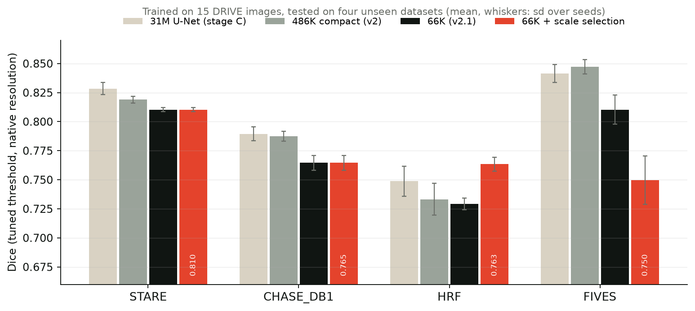</p>

---

## The idea

Retinal vessel maps help screen for diabetes, hypertension and eye disease, but a model trained on one clinic's camera usually degrades on another's.
Real deployments also need models that are **small**, and maps whose vessels stay **connected**, since a missed junction matters more than a missed pixel.
This project asks, under one strict protocol, what each ingredient contributes:

| Question | What we measured |
|---|---|
| **RQ1** Does a topology loss help connectivity? | soft-clDice with a skeleton head, five stages A–E, five seeds each |
| **RQ2** Does a compact backbone pay off? | U-Net vs compact U-Net vs depthwise variants, accuracy against CPU time |
| **RQ3** How small can the model get? | the v2.1 66K U-Net, INT8, and four new topology-based ideas (N1–N4) |
| **RQ4** Is uncertainty useful? | entropy, MC dropout and a 5-model ensemble, at pixel and image level |

**What makes the study trustworthy.** Training uses DRIVE-train only. DRIVE-validation (5 images) is the **only** data used for any choice: checkpoint, threshold, fragment size, backbone, model size.
STARE, CHASE_DB1, HRF and FIVES are touched only after `protocol/decisions.json` is frozen with a SHA-256 hash. Statistics are Holm-corrected, seed-paired intervals plus an image bootstrap.

### Method

<p align="center">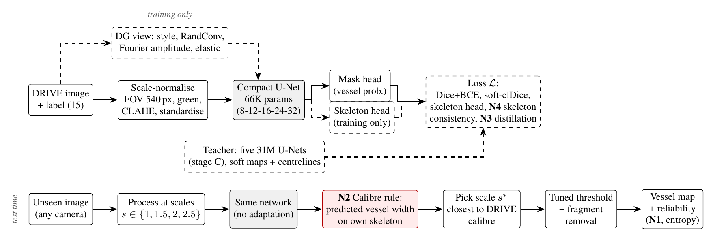</p>

*Top: training uses a robustness-augmented second view, a skeleton head and a teacher, and all of these are dropped at test time (dashed boxes). Bottom: the same network is applied at several scales, and the scale whose predicted vessel calibre matches DRIVE is kept (**N2**).*

---

## Team and responsibilities

The project is split into three equal parts, one for each part of the name **TG-LiteNet**: **T**opology, **G**eneralisation and **Lite**.
Each person owns the ML work, experiments, code, paper sections and website sections for their part, across all three versions (v1, v2 and v2.1). The full breakdown is in [`TEAM.md`](TEAM.md).

| | **Person 1: Topology (T)** | **Person 2: Generalisation (G)** | **Person 3: Lite** |
|---|---|---|---|
| **Owner** | **Abhiraj Agarwal** (2510110002) | **Tanish Shitanshu** (2510110008) | **Shashwat Rajan** (2510111019) |
| Core question | Do vessels stay connected, and can we tell when a prediction is unreliable? | Does the model still work on cameras it never saw? | How small and fast can the model get without losing accuracy? |
| Step in the A–E ladder | **B** topology loss, **E** dropout and uncertainty | **C** augmentation + consistency | **D** compact backbone |
| Novelties | **N1** connectivity reliability score | **N2** calibre-guided scale selection, **N4** skeleton consistency | **N3** topology-aware distillation, plus INT8 quantisation |
| Owns | topology losses (soft-clDice, skeleton head, cbDice, Skeleton Recall), topology metrics, evaluation modes, uncertainty and calibration, statistics | data pipeline, augmentation, consistency loss, the pre-registered protocol | backbones, model-selection rules, distillation, cost measurement, INT8, the training system |
| Main code | `losses.py` (topology), `metrics.py`, `inference.py`, `selection.py`, N1 and statistics in `eval21.py` / `report.py` | `data/`, consistency losses, scale selection in `eval21.py`, `prepare_data.py`, `check_scale_rule.py`, `protocol/` | `models.py`, `train.py`, distillation losses, `efficiency.py`, `int8.py`, `suite.py`, `suite21.py`, `configs/`, run scripts |
| Paper | topology related work, problem setup, topology and uncertainty methods, metrics and statistics, their results | introduction, domain-generalisation related work, preprocessing and N2 method, datasets and protocol, N2/N4 and factorial results | lightweight-network related work, network and distillation methods, training, cost and 66K results, N3, conclusion |
| Website | threshold viewer, N1 card, Scope | scale rule, controls, versions, N2 and N4 cards | hero snapshot, model explorer, N3 card, reproduce, site-data builder |

How the parts connect: Person 2's cleaned data and locked test sets feed everyone; Person 2's stage-C models are the teacher for Person 3's distillation; Person 1's tuned threshold and fragment size are applied after Person 2's scale selection; Persons 1 and 2 supply the loss terms that run inside Person 3's training loop; and Person 3's trained models and cost numbers appear in every table and chart.

---

## Results

All numbers are read from [`results/`](results) at native resolution. "Unseen" is the mean of STARE, CHASE_DB1 and HRF; FIVES (200 images) is reported separately.

### 1. Small, accurate and fast

<p align="center">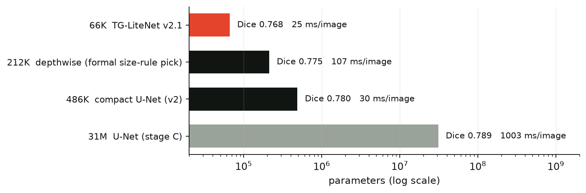</p>

| Model | Params | CPU ms / image | STARE | CHASE_DB1 | HRF | FIVES | **Unseen Dice** | Unseen clDice |
|---|---:|---:|---:|---:|---:|---:|---:|---:|
| 31 M U-Net + topology + DG (stage C) | 31 M | 1003 | 0.828 | 0.789 | 0.749 | 0.842 | 0.789 | 0.836 |
| 486K compact U-Net (v2, stage E) | 486K | 30 | 0.819 | 0.787 | 0.733 | 0.847 | 0.780 | 0.825 |
| **66K TG-LiteNet (v2.1)** | **66K** | **25** | 0.810 | 0.765 | 0.729 | 0.810 | **0.768** | 0.820 |
| **66K + scale selection (N2)** | **66K** | **25** | 0.810 | 0.765 | **0.763** | 0.750 | **0.779** | – |

*Tuned threshold and fragment size chosen on DRIVE-validation, mean over seeds. Published lightweight networks score about 0.03–0.04 higher under different protocols (other training data, scoring resolution and thresholds), so they are context rather than a ranking.*

<p align="center">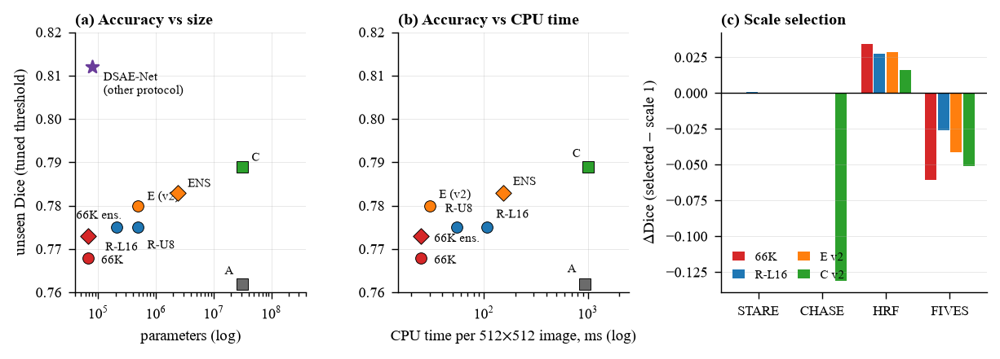</p>

### 2. How the topology loss really behaves

<p align="center"></p>

* The topology loss lowers the **raw Betti-0 error** (fragment count) from **72.8 to 33.9** (stage A to B).
* A simple clean-up that deletes tiny fragments brings **every** model to about **4.5**, so connectivity should be judged **after cleaning**, not from raw fragment counts.
* With the threshold tuned on DRIVE-validation, the unseen Dice is 0.762 (A), 0.775 (B), 0.789 (C) and 0.780 (E): topology costs almost nothing, and the Dice gap at threshold 0.5 is mostly **calibration**.

<p align="center">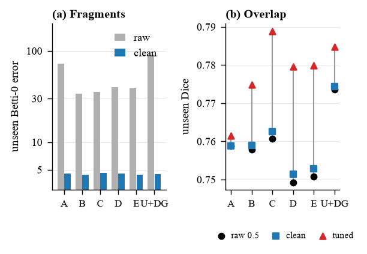</p>

A full 2x2x2 factorial (backbone x topology loss x augmentation) separates the factors: topology lowers raw Betti-0 in all four pairs and raises clDice by 0.006–0.010, robustness augmentation adds 0.006–0.015 raw Dice without topology supervision, and the compact backbone trades about 0.01 Dice for a 31x speed-up.
Plain convolutions were also the faster choice than depthwise-separable ones at equal accuracy.

### 3. A label-free scale rule

Vessels on HRF look thin to a network trained at DRIVE's width. **N2** runs each image at four scales, measures the vessel width the model predicts on its own skeleton, and keeps the scale that matches what it saw in training. No labels, no retraining.

<p align="center">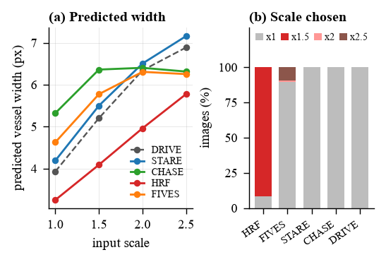</p>

*(a) Mean predicted width at each scale: HRF is thinner than DRIVE at scale 1 and matches it at 1.5. (b) Share of images assigned to each scale: 92% of HRF images pick 1.5, the other datasets keep scale 1.*

| Unseen Dice, 66K model | Tuned | + scale selection | Change |
|---|---:|---:|---:|
| STARE / CHASE_DB1 | 0.810 / 0.765 | 0.810 / 0.765 | 0 (keeps scale 1) |
| **HRF** | 0.729 | **0.763** | **+0.034** |
| FIVES | 0.810 | 0.750 | −0.061 (thick vessels: the default scale is better) |
| **Mean of the three unseen sets** | 0.768 | **0.779** | **+0.011 (clear)** |

The rule is best suited to thin-vessel data, and a thick-vessel guard is a natural refinement. It passed its DRIVE-validation safety check for every model.

### 4. What the model sees

<p align="center">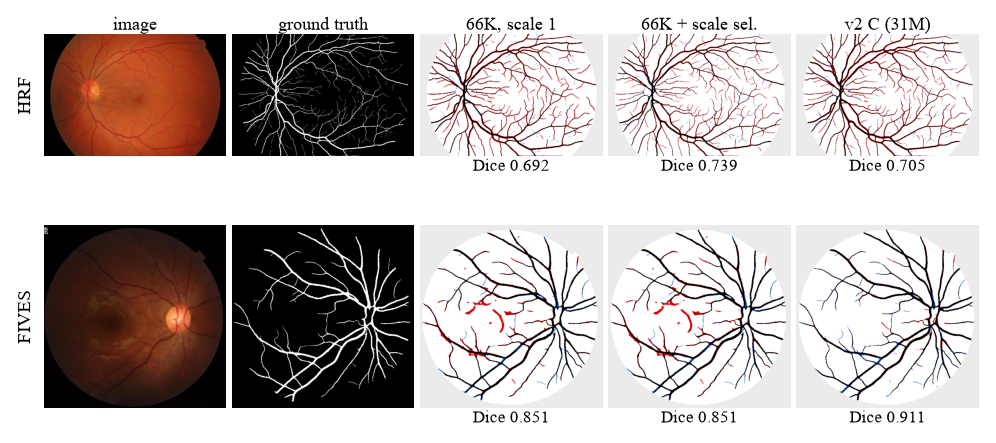</p>

<details>
<summary><b>All five datasets, six models (click to expand)</b></summary>

<p align="center">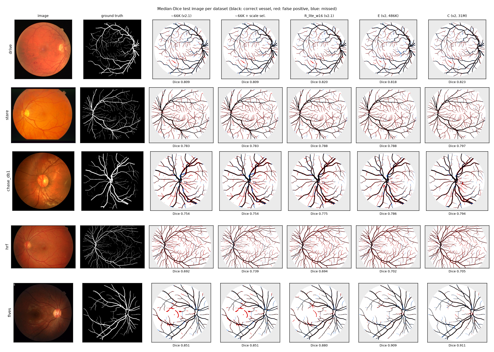</p>

*Median-Dice test image per dataset. Black: correct vessel, red: false positive, blue: missed.*

</details>

### 5. Uncertainty

Entropy is a helpful pixel-level signal (Spearman rho about **0.34** with the error map; rejecting the 10% most uncertain pixels lowers the pixel error from 5.9% to 2.4%).
Ranking whole images by reliability, and carrying calibration from DRIVE to other cameras, are the next open challenges. Ensembles (5x) and MC dropout (20x) cost much more than a single pass.

### 6. Pixel-level classification metrics (66K model)

Vessel segmentation is a binary classification of every pixel in the field of view, so the usual classification metrics apply. Positive (+) is vessel. Each matrix shows the confusion matrix in % of field-of-view pixels (rows: true class, columns: prediction); the grey margins give recall, specificity, precision and accuracy, and F1 equals Dice (tuned threshold, native resolution, mean over images and 5 seeds).

<p align="center">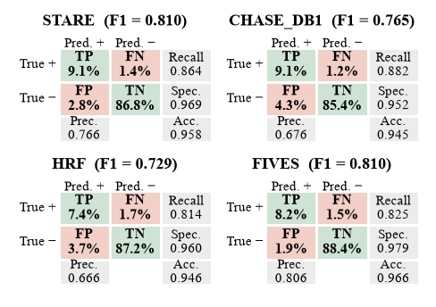</p>

| Dataset | Accuracy | Precision | Recall (sensitivity) | Specificity | F1 (= Dice) |
|---|---:|---:|---:|---:|---:|
| STARE | 0.958 | 0.766 | 0.864 | 0.969 | 0.810 |
| CHASE_DB1 | 0.945 | 0.676 | 0.882 | 0.952 | 0.765 |
| HRF | 0.946 | 0.666 | 0.814 | 0.960 | 0.729 |
| FIVES | 0.966 | 0.806 | 0.825 | 0.979 | 0.810 |

Accuracy is high everywhere but is dominated by the background (85–88% of pixels are true negatives), which is why Dice is the headline. On STARE, CHASE_DB1 and HRF recall exceeds precision, so the remaining error is mostly over-segmentation (false positives 2.8–4.3% of pixels against 1.2–1.7% false negatives).

---

## The four new ideas

The success criteria were fixed (hashed) before training. Ablations use 3 seeds, so a result that is not yet clear is an **open question**, not a closed one.

| | Idea | Owner | Outcome | What it gives us |
|---|---|---|---|---|
| **N2** | Calibre-guided test-time scale selection | Tanish Shitanshu | **Supported** | +0.011 Dice overall (clear), +0.034 on HRF; no labels, no retraining |
| **N1** | Connectivity reliability score (fragment density) | Abhiraj Agarwal | **Promising lead** | the primary target was not met, but secondary connectivity scores (end-point density, small-fragment share) rank failures better than entropy for most models |
| **N3** | Topology-aware distillation (5x 31M teacher) | Shashwat Rajan | **Open question** | no clear effect at 3 seeds; more seeds and data would settle it |
| **N4** | Skeleton-level consistency | Tanish Shitanshu | **Dice trade-off** | pixel-level consistency stays the recommended choice (-0.009 Dice for N4), which narrows the design space |

---

## Versions and branches

| | **v1** (`main`, tag `v1-final`) | **v2** (branch `v2`) | **v2.1** (branch `v2.1-tglite70k`) |
|---|---|---|---|
| Idea | exploration: compact, topology-aware model | the same study rebuilt under a strict protocol | 66K model + four new ideas |
| Selection | explored after seeing results | DRIVE-validation only, protocol hashed | DRIVE-validation only, hashed addendum |
| Targets | STARE, CHASE_DB1, HRF | + FIVES (200 images) | same |
| Main model | 0.21 M depthwise | 0.49 M plain U-Net | **66K U-Net** (8-12-16-24-32 channels) |
| Trained models | 70 (Kaggle, Colab) | 76 (RTX A4000) | 38 (RTX A4000) |

`final-submission` (this branch) holds v2.1, which is a strict superset of v2, plus the paper (`paper/`) and the website (`docs/`).
`results/` holds the v2 study and `results/v21/` the follow-up.

---

## Data

| Dataset | Images | Size (px) | Role |
|---|---:|---|---|
| DRIVE | 40 | 565 x 584 | **train 15 / validation 5** / test 20 |
| STARE | 20 | 700 x 605 | unseen test |
| CHASE_DB1 | 28 | 999 x 960 | unseen test |
| HRF | 45 | 3504 x 2336 | unseen test |
| FIVES | 200 | 2048 x 2048 | extra unseen test |

Datasets are **not** redistributed. Download the archives listed in [`data/README.md`](data/README.md) into `data/` (unextracted): DRIVE (grand-challenge.org; test labels from the PaddleSeg mirror), STARE (cecas.clemson.edu/~ahoover/stare), CHASE_DB1 (Hugging Face `MedOtter/CHASE_DB1`), HRF (www5.cs.fau.de/research/data/fundus-images) and FIVES (doi 10.6084/m9.figshare.19688169).
Then `python scripts/prepare_data.py --overview` checks counts and checksums and prepares standardised copies.

---

## Quick start

Windows, NVIDIA GPU, Python 3.10+ (the results used Python 3.12, PyTorch 2.11, CUDA 12.8):

```powershell
conda create -p .venv python=3.12 pip -c conda-forge
.venv\python.exe -m pip install torch torchvision --index-url https://download.pytorch.org/whl/cu128
.venv\python.exe -m pip install -r requirements.txt
.venv\python.exe -m pip install -e .
.venv\python.exe -m pytest
```

`requirements-lock.txt` lists the exact versions that produced the results.

### Look at the results without any GPU

Every number, table and figure is rebuilt from the committed per-run records:

```powershell
python scripts/make_paper.py            # paper tables, figures and number macros
python scripts/make_site_data.py        # website data and assets
python scripts/make_readme_figs.py      # the figures in this README
python -m http.server --directory docs  # open http://localhost:8000
```

---

## Reproduce everything

```powershell
python scripts/run_all.py --smoke      # 10-minute end-to-end check (writes only runs_smoke/)
python scripts/run_all.py              # the v2 study (resumable)
python scripts/run_v21.py              # the v2.1 follow-up (resumable, about 18.5 h)
python scripts/monitor.py              # live progress
python scripts/make_report.py          # rebuild results/ from runs/
```

Everything is resumable: finished jobs are skipped and training continues from its last checkpoint.
Order of work: data, pilot and backbone selection (DRIVE only), **freeze**, primary stages A–E, factorial, topology variants, warm-up, controls, width. v2.1 repeats the pattern with its own freeze.
Only the trained weights and saved probability maps (about 14 GB) are not committed.

---

## Repository map

```
TEAM.md       who owns what (Topology / Generalisation / Lite), see "Team and responsibilities"
configs/      base.yaml (all hyper-parameters), experiments.yaml (v2 runs), v21.yaml (v2.1 runs)
protocol/     PROTOCOL.md, PROTOCOL_v2.1.md, decisions*.json (budget, backbone, size rule, freeze records with SHA-256)
src/tglite/   data/ (prepare, preprocess, augment, dataset), models, losses, train, inference, selection, evaluate, metrics,
              efficiency, eval21, int8, suite, suite21, report, report21
scripts/      run_all.py (v2), run_v21.py (v2.1), monitor.py, prepare_data.py, train.py (one run),
              make_report.py, make_paper.py, make_site_data.py, make_readme_figs.py, export_assets.py, check_scale_rule.py
tests/        unit tests (losses, metrics, selection, v2.1 additions, resume)
results/      committed, generated results: tables, figures, per-run records; v21/ holds the follow-up (nothing is edited by hand)
paper/        main.tex, overview.tex, generated/ (tables, number macros), figures/, main.pdf
docs/         website: index.html, style.css, app.js, data/site.js, assets/ (example images and maps), img/ (figures), paper.pdf
reports/      GROUP_UPDATE_v2.1.md (internal write-up)
data/         downloaded archives (not committed, see data/README.md)
runs/         checkpoints and saved probability maps (not committed)
```

---

## Scope and limitations

Reading the results with the right context:

* **Data:** 15 training images from one dataset. More training data and multi-dataset training are the most natural next step.
* **Seeds:** ablations use 3 seeds, so a result that is not yet clear is an open question; more seeds would settle N1, N3 and N4.
* **Held-out targets:** no choice depends on target data and every rule is hashed, but the targets are held out rather than untouched, since the v1 numbers were known.
* **Size rule:** the pre-registered rule selected the 212K depthwise network as the formal headline (the 66K model trailed it by only 0.0055 validation Dice), so we show the 66K model as the efficiency point and report both.
* **Scale selection:** best for thin vessels; on thick-vessel FIVES the default scale is better.
* **INT8:** the file shrinks from 266 KB to 109 KB with unchanged Dice; on our desktop CPU it ran slower than FP32, so we claim the smaller file only.
* **Published numbers** use other protocols and are context, not a ranking.

---

## Cite and licence

```bibtex
@misc{tglitenet2026,
  title        = {Compact Topology-Aware Retinal Vessel Segmentation Under Dataset Shift: A Pre-Registered Study of TG-LiteNet with Test-Time Scale Selection},
  author       = {Agarwal, Abhiraj and Rajan, Shashwat and Shitanshu, Tanish},
  year         = {2026},
  howpublished = {CSD361 final project (Group 22), Shiv Nadar Institution of Eminence},
  url          = {https://github.com/Deltasthicc/ML-Project}
}
```

Code: MIT ([LICENSE](LICENSE)). The datasets keep their own licences and are not redistributed; please cite DRIVE (Staal et al. 2004), STARE (Hoover et al. 2000), CHASE_DB1 (Fraz et al. 2012), HRF (Budai et al. 2013) and FIVES (Jin et al. 2022), and the clDice paper (Shit et al. 2021) on which the topology loss is based.
