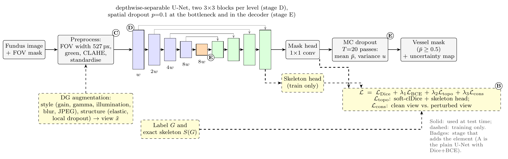
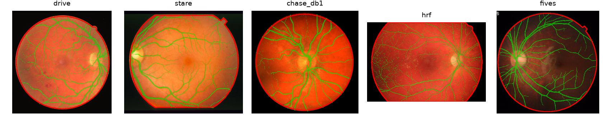
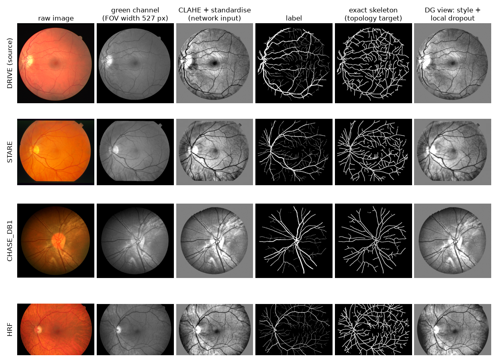
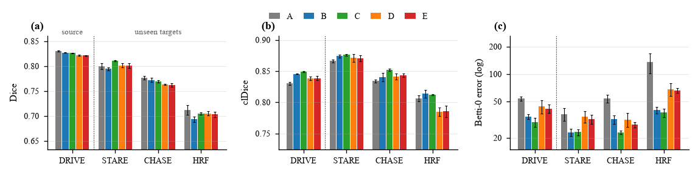
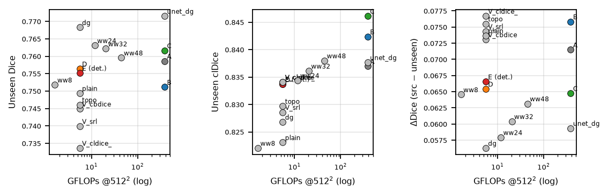
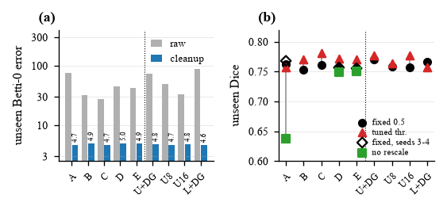
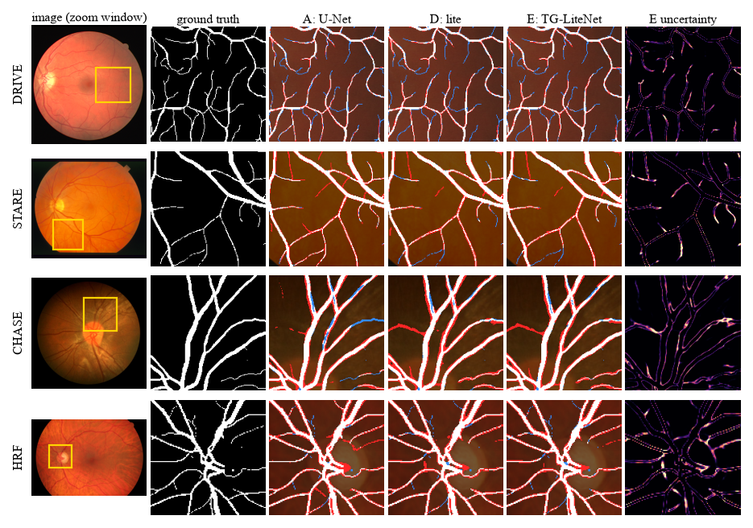
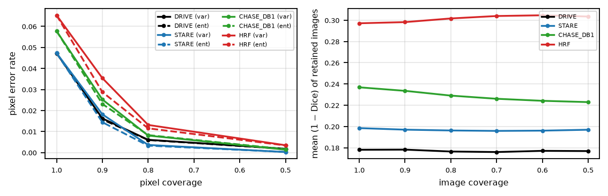

# TG-LiteNet — topology, domain shift and efficiency in retinal vessel segmentation

[](https://github.com/Deltasthicc/ML-Project/actions/workflows/tests.yml)
[](LICENSE)

CSD361 *Introduction to Machine Learning* — final project, Shiv Nadar Institution of Eminence
Abhiraj Agarwal (2510110002) · Shashwat Rajan (2510111019) · Tanish Shitanshu (2510110008)

A **controlled study** of three properties that a vessel segmenter for a rural screening camp needs at the same time:
vessels that stay **connected** (topology), a model that works on cameras it was **never trained on** (domain shift) and a
model that is **small and fast** (efficiency). Everything is trained on **one** source dataset (DRIVE, 16 training images) and
evaluated on three held-out datasets (STARE, CHASE_DB1, HRF). The paper is [`report/main.pdf`](report/main.pdf) (8 pages, IEEE format).

It is a trade-off study, **not** a state-of-the-art claim, and several of our own ideas did not survive their controls:

| Question | Answer from our data |
|---|---|
| Does a topology loss (soft-clDice + skeleton head) help? | It raises clDice (+0.007) and cuts the raw Betti-0 error 75 → 32, at −0.009 Dice at a fixed 0.5 threshold. Simply deleting tiny components brings *every* model to Betti-0 ≈ 5, so the lasting benefit is clDice; with a validation-tuned threshold most of the Dice cost disappears (2 seeds). |
| Does domain-generalisation augmentation help? | Yes, it is the clearest gain: about +0.01 unseen Dice and a smaller DRIVE→target gap. |
| Does the depthwise-separable backbone make it light? | It saves **parameters** (147× fewer) but **not time**: plain compact U-Nets match its Dice at equal or lower CPU latency, and a base-16 U-Net (1.9 M parameters) is also better connected. On this evidence we would deploy the base-16 U-Net. |
| Do the skeleton head, consistency loss and dropout matter? | Not measurably. |
| Is MC-dropout uncertainty useful? | Moderately per pixel (ρ ≈ 0.31–0.34), not for whole-image triage (within 4 % of random, worse on HRF), at 20× the cost. |

## 1. The model and the experiment ladder



```
A  U-Net baseline (Dice+BCE)  →  B  + topology loss (soft-clDice + skeleton head)  →  C  + DG augmentation + consistency
                              →  D  + compact backbone (0.21 M parameters)        →  E  TG-LiteNet = D + MC-dropout uncertainty
```

Around this ladder: a full 2×2×2 factorial design (backbone × topology × DG), topology-loss variants (cbDice, Skeleton Recall),
a width sweep, **plain compact U-Nets** with the same recipe (`compact_unet`) and **ingredient controls** (`controls`: no skeleton head,
no consistency loss), plus evaluation-only controls (small-component removal, validation-tuned thresholds, no-rescale evaluation).
20 configurations, 70 trained models, every one of them recorded in [`results/runs`](results/runs).

## 2. Data and representation

Four public fundus datasets (not redistributed — see §6 for the download scripts and please cite the original papers):

| Dataset | Images | Size (px) | Vessel % | FOV width (px) | Vessel calibre native → normalised (px) | Role |
|---|---:|---|---:|---:|---|---|
| DRIVE (Staal 2004) | 40 | 565×584 | 12.9 | 527 | 3.5 → 3.5 | **source**: train 16 / validation 4 / test 20 |
| STARE (Hoover 2000) | 20 | 700×605 | 10.5 | 638 | 4.3 → 3.5 | unseen target |
| CHASE_DB1 (Fraz 2012) | 28 | 999×960 | 10.3 | 899 | 6.1 → 3.6 | unseen target |
| HRF (Budai 2013) | 45 | 3504×2336 | 9.1 | 3262 | 8.8 → 1.4 | unseen target |

(statistics measured on the files used in the experiments; FIVES, 200 images, is supported by the code but was not used.)
Cameras differ in colour balance, field of view and resolution by up to 6×, which is the domain shift the study measures.
The classes are imbalanced (9–13 % vessel pixels); there are no missing values or categorical attributes.



**How an image becomes a network input.** Every image is rescaled so its field of view is 527 px wide (DRIVE's median; this uses no
labels and no target statistics), the green channel is kept (best vessel contrast), the outside of the FOV is replaced by the FOV
mean, CLAHE is applied with 64-px tiles, and the result is standardised inside the FOV and set to zero outside. The topology target
is the exact skeleton of the label, and the DG stages additionally train on a perturbed second view (style: gain/gamma/contrast,
illumination field, blur, noise, JPEG; structure: elastic warp, local intensity dropout). Metrics are always computed against the
**native-resolution** labels inside the FOV (the probability map is resampled to them).



**Protocol.** DRIVE-train is the only data used for fitting; DRIVE-validation (4 images) is used for checkpoint selection (best Dice)
and for choosing the cleanup size and per-model thresholds of the evaluation-only controls; STARE, CHASE_DB1 and HRF are test-only; the
decision threshold of all main results is fixed at 0.5; all stages share one optimiser, schedule and data pipeline
([`configs/base.yaml`](configs/base.yaml)). The targets were never used for fitting, tuning or checkpoint selection, but their results
were inspected while designing the analyses, so they are held-out rather than untouched.

## 3. Results

Mean over seeds (5 for stages A–E, 3 for the others); *unseen* = macro average of STARE, CHASE_DB1 and HRF; threshold 0.5. Generated from
`results/tables` by [`scripts/make_readme_results.py`](scripts/make_readme_results.py).

**Staged ablation**

|  | DRIVE Dice | unseen Dice | unseen clDice | unseen Betti-0 err | params (M) | GFLOPs | CPU ms* | seeds |
|---|---:|---:|---:|---:|---:|---:|---:|---:|
| A  U-Net (Dice+BCE) | 0.830 | 0.762 | 0.835 | 75.0 | 31.04 | 384.7 | 1834 | 5 |
| B  + topology loss | 0.827 | 0.753 | 0.843 | 31.7 | 31.04 | 384.7 | 1834 | 5 |
| C  + DG augmentation | 0.826 | 0.761 | 0.847 | 27.9 | 31.04 | 384.7 | 1834 | 5 |
| D  + compact backbone | 0.822 | 0.757 | 0.832 | 44.7 | 0.21 | 5.5 | 209 | 5 |
| E  TG-LiteNet (deterministic) | 0.822 | 0.755 | 0.833 | 41.9 | 0.21 | 5.5 | 209 | 5 |
| E  TG-LiteNet (MC dropout, T=20) | 0.822 | 0.756 | 0.833 | 42.7 | 0.21 | 5.5 | 4178 | 5 |

**Controls and compact baselines**

|  | DRIVE Dice | unseen Dice | unseen clDice | unseen Betti-0 err | params (M) | GFLOPs | CPU ms* | seeds |
|---|---:|---:|---:|---:|---:|---:|---:|---:|
| U-Net + DG, no topology loss | 0.831 | 0.771 | 0.837 | 73.0 | 31.04 | 384.7 | 1834 | 3 |
| plain compact U-Net, base 8 | 0.821 | 0.758 | 0.833 | 48.9 | 0.49 | 6.0 | 67 | 3 |
| plain compact U-Net, base 16 | 0.823 | 0.757 | 0.840 | 33.7 | 1.94 | 24.1 | 187 | 3 |
| D without skeleton head | 0.822 | 0.761 | 0.831 | 53.8 | 0.21 | 5.5 | 209 | 3 |
| D without consistency loss | 0.822 | 0.759 | 0.833 | 52.2 | 0.21 | 5.5 | 209 | 3 |

\* one 512×512 image, 4 CPU threads, controlled laptop benchmark (`results/tables/latency_laptop.csv`); the MC row is T = 20 passes.
Per-run latencies measured on the shared cloud machines varied by up to 2× for identical models and are only kept in `efficiency*.json`.



| Accuracy vs. connectivity and cost | Evaluation-only checks |
|---|---|
|  |  |

*Left:* unseen Dice against unseen clDice and CPU latency (marker area ∝ parameters). *Right:* removing small components collapses the
Betti-0 error of every model (a), and a validation-tuned threshold changes the Dice ranking (b); "no rescale" shows that the plain U-Net depends on the FOV normalisation.



*One test image per dataset (seed 0). The yellow window is where stages A and E disagree most; white = true positive, red = false positive, blue = false negative.
The MC-dropout uncertainty (right) marks vessel borders and thin segments in general rather than the errors in particular.*



All other tables (confusion matrix with precision/recall/F1, factorial design, variants, paired statistics, uncertainty) are in the paper and
in [`results/tables/`](results/tables); [`results/findings.md`](results/findings.md) is an auto-generated list of facts with their intervals.

## 4. Repository map

```
.
├── tglite/                  the library
│   ├── models/              unet.py (baseline), litenet.py (depthwise-separable backbone, mask + skeleton heads, MC dropout)
│   ├── data/                preprocess.py (FOV, scale normalisation, CLAHE), augment.py (style/structure DG), datasets.py (train/eval datasets)
│   ├── losses.py            Dice, BCE, soft-clDice, skeleton head loss, Skeleton Recall, cbDice, consistency
│   ├── metrics.py           Dice/IoU/AUC, clDice, cbDice, Betti-0/1 errors (8-connectivity, Euler number)
│   ├── uncertainty.py       MC-dropout mean/variance, entropy, risk-coverage, Spearman correlations
│   ├── efficiency.py        parameters, FLOPs (2 x MACs), CPU/GPU latency and memory
│   ├── train.py / evaluate.py / predict.py   training loop, per-image evaluation, inference
│   ├── experiments.py       registry of every experiment (stages, factorial cells, variants, widths, controls) and the run groups
│   └── analysis.py          per-run tables, seed-level paired intervals, stratified image bootstrap, confusion matrix
├── configs/base.yaml        all hyper-parameters (experiments are overrides in tglite/experiments.py, not extra YAML files)
├── scripts/
│   ├── download_data.py, prepare_data.py, make_data_overview.py     data
│   ├── train.py, run_experiments.py, evaluate.py, tune_lambdas.py   training and evaluation (resumable runner)
│   ├── eval_postproc.py     evaluation-only controls: small-component removal, tuned threshold
│   ├── benchmark_latency.py controlled CPU latency benchmark
│   ├── aggregate_results.py, auto_findings.py, make_run_manifest.py tables, findings, run manifest
│   ├── make_report_assets.py, make_readme_results.py, make_readme_figures.py   paper tables/figures and README assets
│   └── kaggle_run.sh, run_all.sh/.ps1                               drivers for the cloud / local full run
├── splits/drive_split.json  fixed DRIVE split: train 16 / validation 4 / test 20
├── tests/                   34 unit tests (losses, Betti numbers, metrics, augmentation alignment, MC dropout, statistics, ...)
├── results/
│   ├── runs/<exp>/seed<k>/  config.yaml, train_log.csv, per_image*.csv, efficiency*.json, env.json   (checkpoints are git-ignored)
│   ├── tables/              every aggregate table as CSV (summary, stage/factorial deltas, paired image deltas, confusion, ...)
│   └── findings.md          auto-generated facts
├── report/                  main.tex, main.pdf, generated/ (tables + number macros), figures/
├── docs/img/                architecture and preprocessing figures used in this README
├── RUNBOOK.md               step-by-step checklist for the full run on a powerful machine
└── data/                    NOT in git: raw/, processed/, MANIFEST.json (checksums)
```

## 5. Quick start

```bash
python -m venv .venv && source .venv/bin/activate          # Windows: .venv\Scripts\activate
pip install torch --index-url https://download.pytorch.org/whl/cu126   # 1) PyTorch first, matching your CUDA driver (or the CPU build)
pip install -r requirements.txt && pip install -e .                    # 2) everything else + the package
pytest -q                                                              # 34 tests, ~15 s on CPU, no data needed
```

Python 3.12+ and PyTorch ≥ 2.3. The code is device-agnostic (CUDA + fp16 autocast when available, CPU otherwise).

**Look at the results without any data or training:** open [`report/main.pdf`](report/main.pdf), the CSVs in `results/tables`, or regenerate
tables and figures from the committed per-image results:

```bash
python scripts/aggregate_results.py          # results/runs -> results/tables/*.csv
python scripts/make_report_assets.py         # -> report/generated/*.tex and report/figures/*
python scripts/make_readme_results.py        # the Markdown tables of §3
cd report && pdflatex main && pdflatex main  # the paper (8 pages)
```

## 6. Running the experiments

**Data** (~140 MB for the four datasets; the scripts verify image counts, sizes and SHA-256 checksums):

```bash
python scripts/download_data.py            # DRIVE, STARE, CHASE_DB1, HRF   [--fives: FIVES, 1.8 GB, optional]
python scripts/prepare_data.py             # -> data/processed/<dataset>/{images,masks,fov}/ + stats.json
python scripts/make_data_overview.py       # contact sheet to check labels / FOV outlines visually
```

DRIVE and CHASE_DB1 come from third-party mirrors (the official sites need a login or were unreachable); STARE and HRF from the official
sites. FOV masks of DRIVE, STARE and CHASE_DB1 are estimated; HRF has official ones. See `data/MANIFEST.json` and the paper's limitations.

**Training and evaluation** (resumable: finished runs are skipped; `RUNBOOK.md` has timings and the recommended order):

```bash
python scripts/run_experiments.py --groups primary --quick                  # smoke test, ~1 min, numbers are meaningless
python scripts/run_experiments.py --groups primary --native-eval            # stages A-E x 5 seeds
python scripts/run_experiments.py --groups factorial topology width compact_unet controls   # the other 15 configurations x 3 seeds
python scripts/train.py --exp E_tglitenet --seed 0 --evaluate --set train.iters=8000       # one run, any config override
python scripts/evaluate.py results/runs/E_tglitenet/seed3 --datasets drive stare            # re-evaluate a checkpoint
```

Experiment names: `A_unet`, `B_unet_topo`, `C_unet_topo_dg`, `D_lite_topo_dg`, `E_tglitenet` (stages); `X_unet_dg`, `X_lite_plain`, `X_lite_topo`,
`X_lite_dg` (factorial); `V_lite_cbdice`, `V_lite_srl`, `V_lite_cldice_srl` (topology variants); `W_lite_w{8,24,32,48}` (width);
`S_unet_b8`, `S_unet_b16` (plain compact U-Nets); `Z_lite_noskel`, `Z_lite_nocons` (controls). Default seeds: 5 for `primary`, 3 for every other group.

Evaluation-only controls on trained checkpoints (cut-off and thresholds are chosen on DRIVE-validation only):

```bash
python scripts/eval_postproc.py --runs results/runs --seeds 3 4             # small-component removal + tuned threshold -> postproc_summary.csv
python scripts/run_experiments.py --exp A_unet D_lite_topo_dg E_tglitenet --seeds 3 4 --no-train --native-eval   # no-rescale evaluation
python scripts/benchmark_latency.py --name laptop --threads 4               # controlled CPU latency benchmark
```

**Per run** (`results/runs/<exp>/seed<k>/`): `config.yaml` (exact config), `train_log.csv`, `per_image.csv` (every metric per image and mode `det`/`mc`),
`per_image_pp.csv` / `per_image_native.csv` (controls), `efficiency.json`, `env.json` (commit and library versions), `best.pt` (git-ignored) and `preds/` (git-ignored).

## 7. Reproducibility

* Seeds control initialisation, data order and augmentation. GPU kernels are not bit-wise deterministic, so re-running gives numbers that agree
  *statistically*; that is why everything is reported as mean ± std / interval over seeds (paired over shared seeds for differences).
* The 70 reported runs come from two environments (37 on a Kaggle T4, CUDA 12.8; 33 on a Colab L4, CUDA 13.0) and three code commits that differ only in
  analysis code and added experiments. [`results/tables/run_manifest.csv`](results/tables/run_manifest.csv) lists the commit, GPU and PyTorch build of every run;
  [`reported-environment.txt`](reported-environment.txt) summarises the main library versions (it is not a full lock file).
* Every number in the paper's tables comes from `results/runs` through `aggregate_results.py` → `make_report_assets.py`. Numbers typed into the paper's
  prose were checked against those tables; re-check them if you re-run the experiments.
* **Checkpoints are not in the repository** (size). Re-evaluating a checkpoint (checked for stage A seed 3 on DRIVE and STARE) reproduced the committed per-image metrics to ~1e-5 (CPU vs. GPU rounding);
  without checkpoints the committed `per_image*.csv` files are the record of the results and the experiments are reproducible by retraining.
  `evaluate.py` loads checkpoints with `weights_only=False` (they store the config), so only load checkpoints you trust.

## 8. Limitations

Only 16 training images and 4 validation images; FOV masks of four datasets are estimated and labels are first-observer only; raw Betti-0 counts
are fragile (cleanup removes the effect); the DG stage bundles augmentation, a consistency term and a second view; uncertainty is evaluated as a ranking,
not calibrated; latency is eager-PyTorch on a laptop CPU, not an edge device; soft-clDice, Skeleton Recall and cbDice are our re-implementations;
source-only numbers are not comparable with multi-source or test-time-adaptation papers. The paper's Section VII-A has the complete list.

## 9. Licence, data, references

The code is released under the [MIT licence](LICENSE). The datasets keep their own licences and are not redistributed: DRIVE (Staal et al., 2004),
STARE (Hoover et al., 2000), CHASE_DB1 (Fraz et al., 2012), HRF (Budai et al., 2013), optionally FIVES (Jin et al., 2022). The losses follow the descriptions in
clDice (Shit et al., CVPR 2021), cbDice (Shi et al., MICCAI 2024) and Skeleton Recall (Kirchhoff et al., ECCV 2024) and are our own implementations, not copied from the
authors' repositories. Full references are in the paper.
